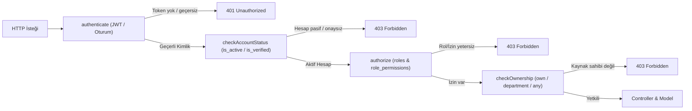

# 🗄️ Database Design Documentation (DDD)
## Alumni Tracking System

> **Belge Sürümü:** 1.3.0  
> **Tarih:** 2026-11-25  
> **Durum:** Güncellendi (Yetkilendirme / RBAC Mimarisi Eklendi)  
> **Hedef RDBMS:** PostgreSQL 16+ (İlişkisel Veritabanı Mimarisi)  
> **Uygulama:** Temel şema `backend/src/db/schema.sql` dosyasında DDL olarak üretilmiş ve `alumni_db` PostgreSQL veritabanında aktif olarak oluşturulmuştur. Yetkilendirme (RBAC) tabloları ve erişim politikaları bu belgede standartlaştırılmıştır.

---

## 📑 İçindekiler
1. [Giriş ve Tasarım İlkeleri](#1-giriş-ve-tasarım-ilkeleri)
2. [Varlık İlişki Diyagramı (ER Diagram)](#2-varlık-ilişki-diyagramı-er-diagram)
3. [Tablo Tasarımları ve Veri Sözlüğü](#3-tablo-tasarımları-ve-veri-sözlüğü)
   - [3.1 departments (Bölümler)](#31-departments-bölümler)
   - [3.2 users (Temel Kullanıcı Hesabı)](#32-users-temel-kullanıcı-hesabı)
   - [3.3 alumni_profiles (Mezun Profilleri)](#33-alumni_profiles-mezun-profilleri)
   - [3.4 student_profiles (Öğrenci Profilleri)](#34-student_profiles-öğrenci-profilleri)
   - [3.5 academic_profiles (Akademik Personel Profilleri)](#35-academic_profiles-akademik-personel-profilleri)
   - [3.6 job_experiences (Kariyer ve İş Deneyimleri)](#36-job_experiences-kariyer-ve-iş-deneyimleri)
   - [3.7 job_postings (İş ve Staj İlanları)](#37-job_postings-iş-ve-staj-ilanları)
   - [3.8 mentorship_requests (Mentörlük Talepleri)](#38-mentorship_requests-mentörlük-talepleri)
   - [3.9 events (Etkinlikler)](#39-events-etkinlikler)
   - [3.10 event_rsvps (Etkinlik Katılım Durumları)](#310-event_rsvps-etkinlik-katılım-durumları)
   - [3.11 announcements (Duyurular)](#311-announcements-duyurular)
   - [3.12 applications (İş ve Staj Başvuruları)](#312-applications-iş-ve-staj-başvuruları)
   - [3.13 roles (Sistem Rolleri)](#313-roles-sistem-rolleri)
   - [3.14 permissions (Sistem İzinleri / Yetkiler)](#314-permissions-sistem-izinleri--yetkiler)
   - [3.15 role_permissions (Rol-İzin Eşleşmeleri)](#315-role_permissions-rol-izin-eşleşmeleri)
   - [3.16 user_roles (Kullanıcı-Rol Atamaları)](#316-user_roles-kullanıcı-rol-atamaları)
   - [3.17 refresh_tokens (Oturum ve Yenileme Tokenları)](#317-refresh_tokens-oturum-ve-yenileme-tokenları)
4. [İlişki ve Kardinalite Özeti](#4-ilişki-ve-kardinalite-özeti)
5. [İndeksleme ve Performans Optimizasyonları](#5-indeksleme-ve-performans-optimizasyonları)
6. [Yetkilendirme ve Rol Tabanlı Erişim Kontrolü (Authorization & RBAC)](#6-yetkilendirme-ve-rol-tabanlı-erişim-kontrolü-authorization--rbac)
   - [6.1 Sistem Rolleri ve Hiyerarşi](#61-sistem-rolleri-ve-hiyerarşi)
   - [6.2 Kaynak Bazlı Yetki Matrisi (Role–Permission Matrix)](#62-kaynak-bazlı-yetki-matrisi-rolepermission-matrix)
   - [6.3 Kaynak Sahipliği ve Kapsam Kuralları (Scope & Ownership Policies)](#63-kaynak-sahipliği-ve-kapsam-kuralları-scope--ownership-policies)
   - [6.4 Yetkilendirme Middleware Akışı ve Durum Kodları](#64-yetkilendirme-middleware-akışı-ve-durum-kodları)

---

## 1. Giriş ve Tasarım İlkeleri

Alumni Tracking System; mezunlar, aktif öğrenciler ve akademisyenler arasındaki etkileşimi, iş/staj ilanlarını, mentörlük eşleşmelerini ve etkinlik yönetimini sağlayan birleşik bir platformdur. 

### Temel Tasarım Prensipleri:
- **3. Normal Form (3NF):** Veri tekrarlarını önlemek ve tutarsızlıkları minimize etmek için 3NF standardında normalize edilmiştir.
- **Rol Tabanlı Ayrık Profil Modeli (Table Inheritance / Extension Pattern):** Ortak kimlik ve kimlik doğrulama verileri `users` tablosunda toplanmış; role özgü detaylar (`alumni_profiles`, `student_profiles`, `academic_profiles`) 1-e-1 ilişkilerle ayrıştırılmıştır.
- **Rol Tabanlı Erişim Kontrolü ve Sahiplik Politikaları (RBAC + Ownership):** Kullanıcı rolleri (`roles`), granüler izinler (`permissions`), rol-izin eşleşmeleri (`role_permissions`) ve çoklu rol desteği (`user_roles`) ilişkisel olarak modellenir; kritik işlemlerde kaynak sahipliği (ownership) ve hesap durumu (`is_active`, `is_verified`) denetlenir.
- **Veri Bütünlüğü (Data Integrity & Foreign Keys):** Tüm ilişkiler katı `FOREIGN KEY` kısıtlamaları ve `ON DELETE` kurallarıyla (`CASCADE` / `SET NULL` / `RESTRICT`) korunur.
- **Audit İzlenebilirliği (Audit Trail):** Tüm ana tablolarda `created_at` ve `updated_at` zaman damgaları yer alır.

---

## 2. Varlık İlişki Diyagramı (ER Diagram)

```mermaid
erDiagram
    departments ||--o{ users : "ait_olabilir"
    departments ||--o{ alumni_profiles : "mezun_olunan"
    departments ||--o{ student_profiles : "okunan"
    departments ||--o{ academic_profiles : "gorev_yapilan"
    departments ||--o{ job_postings : "hedef_bolum"

    users ||--o| alumni_profiles : "genisletir (1:1)"
    users ||--o| student_profiles : "genisletir (1:1)"
    users ||--o| academic_profiles : "genisletir (1:1)"

    alumni_profiles ||--o{ job_experiences : "sahiptir"
    users ||--o{ job_postings : "paylasir"
    
    users ||--o{ mentorship_requests : "talep_eder (ogrenci)"
    alumni_profiles ||--o{ mentorship_requests : "rehberlik_eder (mentor)"

    users ||--o{ events : "olusturur"
    events ||--o{ event_rsvps : "katilimcilar"
    users ||--o{ event_rsvps : "katilir"

    users ||--o{ announcements : "yayinlar"
    job_postings ||--o{ applications : "basvurulari_icerir"
    users ||--o{ applications : "basvurur"

    users ||--o{ user_roles : "atanir"
    roles ||--o{ user_roles : "tanimlar"
    roles ||--o{ role_permissions : "yetkilendirir"
    permissions ||--o{ role_permissions : "atanir"
    users ||--o{ refresh_tokens : "oturum_acar"

    departments {
        int id PK
        varchar code UK
        varchar name
        varchar faculty
    }

    users {
        int id PK
        varchar email UK
        varchar password_hash
        varchar role
        varchar first_name
        varchar last_name
        boolean is_active
        timestamp created_at
    }

    alumni_profiles {
        int id PK
        int user_id FK,UK
        int department_id FK
        int graduation_year
        varchar current_job_title
        varchar current_company
        boolean available_for_mentorship
    }

    student_profiles {
        int id PK
        int user_id FK,UK
        int department_id FK
        varchar student_number UK
        int enrollment_year
        int expected_graduation_year
    }

    academic_profiles {
        int id PK
        int user_id FK,UK
        int department_id FK
        varchar academic_title
        varchar office_location
    }

    job_experiences {
        int id PK
        int alumni_profile_id FK
        varchar company
        varchar position
        date start_date
        date end_date
        boolean is_current
    }

    job_postings {
        int id PK
        int posted_by_user_id FK
        int department_id FK
        varchar title
        varchar company
        varchar city
        varchar wage
        varchar job_type
        varchar short_description
        text description
        boolean is_active
    }

    mentorship_requests {
        int id PK
        int student_user_id FK
        int mentor_alumni_id FK
        varchar status
        text request_message
    }

    events {
        int id PK
        int created_by_user_id FK
        varchar title
        timestamp event_date
        varchar location
        int capacity
    }

    event_rsvps {
        int id PK
        int event_id FK
        int user_id FK
        varchar status
    }

    announcements {
        int id PK
        int author_id FK
        varchar title
        text content
        varchar category
        boolean is_pinned
    }

    applications {
        int id PK
        int job_posting_id FK
        int applicant_user_id FK
        varchar status
        varchar resume_url
        text cover_letter
        timestamp created_at
    }

    roles {
        int id PK
        varchar name UK
        varchar display_name
        smallint hierarchy_level
        boolean is_system_role
    }

    permissions {
        int id PK
        varchar code UK
        varchar resource
        varchar action
        varchar scope
    }

    role_permissions {
        int id PK
        int role_id FK
        int permission_id FK
        timestamp granted_at
    }

    user_roles {
        int id PK
        int user_id FK
        int role_id FK
        int assigned_by_user_id FK
        timestamp assigned_at
        timestamp expires_at
    }

    refresh_tokens {
        int id PK
        int user_id FK
        varchar token_hash UK
        timestamp expires_at
        timestamp revoked_at
    }
```

---

## 3. Tablo Tasarımları ve Veri Sözlüğü

### 3.1 `departments` (Bölümler)
Üniversitedeki akademik bölümleri tutar.

| Sütun Adı | Veri Tipi | Kısıtlar (Constraints) | Açıklama |
|---|---|---|---|
| `id` | `SERIAL` | `PRIMARY KEY` | Benzersiz bölüm ID |
| `code` | `VARCHAR(20)` | `NOT NULL`, `UNIQUE` | Bölüm kodu (ör. `CENG`, `EEE`, `ME`) |
| `name` | `VARCHAR(150)` | `NOT NULL` | Bölüm adı (ör. Bilgisayar Mühendisliği) |
| `faculty` | `VARCHAR(150)` | `NOT NULL` | Bağlı olduğu fakülte adı |
| `description` | `TEXT` | `NULL` | Bölüm hakkında kısa bilgi |
| `created_at` | `TIMESTAMP` | `NOT NULL`, `DEFAULT NOW()` | Kayıt tarihi |

---

### 3.2 `users` (Temel Kullanıcı Hesabı)
Platformdaki tüm kullanıcıların temel kimlik, giriş ve rol bilgilerini içerir.

| Sütun Adı | Veri Tipi | Kısıtlar (Constraints) | Açıklama |
|---|---|---|---|
| `id` | `SERIAL` | `PRIMARY KEY` | Benzersiz kullanıcı ID |
| `email` | `VARCHAR(255)` | `NOT NULL`, `UNIQUE` | Giriş e-posta adresi |
| `password_hash` | `VARCHAR(255)` | `NOT NULL` | Argon2 veya bcrypt hash'i |
| `role` | `VARCHAR(30)` | `NOT NULL`, `CHECK (role IN ('alumni', 'student', 'academic_staff', 'admin'))` | Birincil kullanıcı rolü (hızlı erişim ve geriye dönük uyumluluk için; çoklu rol atamaları `user_roles` tablosu ile yönetilir) |
| `first_name` | `VARCHAR(100)` | `NOT NULL` | Ad |
| `last_name` | `VARCHAR(100)` | `NOT NULL` | Soyad |
| `phone` | `VARCHAR(30)` | `NULL` | Telefon numarası |
| `profile_image_url` | `VARCHAR(500)` | `NULL` | Profil fotoğrafı URL adresi |
| `is_active` | `BOOLEAN` | `NOT NULL`, `DEFAULT TRUE` | Hesap aktif mi? |
| `is_verified` | `BOOLEAN` | `NOT NULL`, `DEFAULT FALSE` | E-posta doğrulaması tamamlandı mı? |
| `created_at` | `TIMESTAMP` | `NOT NULL`, `DEFAULT NOW()` | Kayıt oluşturulma zamanı |
| `updated_at` | `TIMESTAMP` | `NOT NULL`, `DEFAULT NOW()` | Son güncelleme zamanı |

---

### 3.3 `alumni_profiles` (Mezun Profilleri)
Mezun rolündeki kullanıcıların detaylı eğitim ve kariyer durumlarını barındırır (`users` ile 1-e-1 ilişki).

| Sütun Adı | Veri Tipi | Kısıtlar (Constraints) | Açıklama |
|---|---|---|---|
| `id` | `SERIAL` | `PRIMARY KEY` | Profil ID |
| `user_id` | `INTEGER` | `NOT NULL`, `UNIQUE`, `REFERENCES users(id) ON DELETE CASCADE` | İlgili kullanıcı |
| `department_id` | `INTEGER` | `NOT NULL`, `REFERENCES departments(id) ON DELETE RESTRICT` | Mezun olunan bölüm |
| `graduation_year` | `SMALLINT` | `NOT NULL`, `CHECK (graduation_year >= 1950)` | Mezuniyet yılı |
| `degree` | `VARCHAR(50)` | `NOT NULL`, `DEFAULT 'Bachelor'` | Lisans / Yüksek Lisans / Doktora |
| `current_job_title` | `VARCHAR(150)` | `NULL` | Güncel pozisyon/ünvan |
| `current_company` | `VARCHAR(150)` | `NULL` | Çalıştığı şirket/kurum |
| `current_city` | `VARCHAR(100)` | `NULL` | İkamet ettiği şehir / ülke |
| `linkedin_url` | `VARCHAR(300)` | `NULL` | LinkedIn profil bağlantısı |
| `bio` | `TEXT` | `NULL` | Özgeçmiş veya kısa biyografi |
| `available_for_mentorship` | `BOOLEAN` | `NOT NULL`, `DEFAULT FALSE` | Öğrencilere mentörlük vermeye açık mı? |
| `updated_at` | `TIMESTAMP` | `NOT NULL`, `DEFAULT NOW()` | Güncelleme zamanı |

---

### 3.4 `student_profiles` (Öğrenci Profilleri)
Aktif öğrenci rolündeki kullanıcıların detaylarını barındırır (`users` ile 1-e-1 ilişki).

| Sütun Adı | Veri Tipi | Kısıtlar (Constraints) | Açıklama |
|---|---|---|---|
| `id` | `SERIAL` | `PRIMARY KEY` | Profil ID |
| `user_id` | `INTEGER` | `NOT NULL`, `UNIQUE`, `REFERENCES users(id) ON DELETE CASCADE` | İlgili kullanıcı |
| `department_id` | `INTEGER` | `NOT NULL`, `REFERENCES departments(id) ON DELETE RESTRICT` | Okuduğu bölüm |
| `student_number` | `VARCHAR(30)` | `NOT NULL`, `UNIQUE` | Öğrenci numarası |
| `enrollment_year` | `SMALLINT` | `NOT NULL` | Giriş yılı |
| `expected_graduation_year` | `SMALLINT` | `NOT NULL` | Tahmini mezuniyet yılı |
| `degree` | `VARCHAR(50)` | `NOT NULL`, `DEFAULT 'Bachelor'` | Lisans / Yüksek Lisans |
| `interests` | `TEXT` | `NULL` | İlgi alanları ve teknolojiler |
| `career_goals` | `TEXT` | `NULL` | Kariyer hedefleri |
| `updated_at` | `TIMESTAMP` | `NOT NULL`, `DEFAULT NOW()` | Güncelleme zamanı |

---

### 3.5 `academic_profiles` (Akademik Personel Profilleri)
Öğretim görevlileri ve fakülte danışmanlarının bilgilerini barındırır (`users` ile 1-e-1 ilişki).

| Sütun Adı | Veri Tipi | Kısıtlar (Constraints) | Açıklama |
|---|---|---|---|
| `id` | `SERIAL` | `PRIMARY KEY` | Profil ID |
| `user_id` | `INTEGER` | `NOT NULL`, `UNIQUE`, `REFERENCES users(id) ON DELETE CASCADE` | İlgili akademisyen |
| `department_id` | `INTEGER` | `NOT NULL`, `REFERENCES departments(id) ON DELETE RESTRICT` | Görevli olduğu bölüm |
| `academic_title` | `VARCHAR(100)` | `NOT NULL` | Akademik unvan (Prof. Dr., Doç. Dr., vb.) |
| `office_location` | `VARCHAR(150)` | `NULL` | Ofis numarası / bina |
| `research_areas` | `TEXT` | `NULL` | Çalışma ve araştırma alanları |
| `office_hours` | `VARCHAR(200)` | `NULL` | Danışmanlık ve ofis saatleri |
| `updated_at` | `TIMESTAMP` | `NOT NULL`, `DEFAULT NOW()` | Güncelleme zamanı |

---

### 3.6 `job_experiences` (Kariyer ve İş Deneyimleri)
Mezunların geçmiş ve mevcut çalışma tecrübelerini kronolojik olarak saklar.

| Sütun Adı | Veri Tipi | Kısıtlar (Constraints) | Açıklama |
|---|---|---|---|
| `id` | `SERIAL` | `PRIMARY KEY` | Deneyim ID |
| `alumni_profile_id`| `INTEGER` | `NOT NULL`, `REFERENCES alumni_profiles(id) ON DELETE CASCADE` | İlgili mezun profili |
| `company` | `VARCHAR(150)` | `NOT NULL` | Şirket adı |
| `position` | `VARCHAR(150)` | `NOT NULL` | Rol / Unvan |
| `start_date` | `DATE` | `NOT NULL` | Başlangıç tarihi |
| `end_date` | `DATE` | `NULL` | Bitiş tarihi (aktif çalışıyorsa NULL) |
| `is_current` | `BOOLEAN` | `NOT NULL`, `DEFAULT FALSE` | Güncel işi mi? |
| `description` | `TEXT` | `NULL` | Görev tanımı ve sorumluluklar |

---

### 3.7 `job_postings` (İş ve Staj İlanları)
Mezunlar veya akademisyenler tarafından paylaşılan iş/staj fırsatları.

#### 📌 İş Kuralları ve Doğrulama Kriterleri (Business & Validation Rules)
- **Title Required & Max Length:** İlan başlığı (`title`) zorunludur (`NOT NULL`) ve en fazla 120 karakter olabilir (`VARCHAR(120)`).
- **Company Required:** İlanı veren şirket/kurum adı (`company`) zorunludur (`NOT NULL`).
- **City Explicit & Required:** İlanın geçerli olduğu şehir (`city`) ilanda açık ve net bir şekilde belirtilmelidir (`NOT NULL`).
- **Short Description Required:** Tüm iş ilanlarında pozisyona dair kısa bir açıklama/özet (`short_description`) bulunması zorunludur (`NOT NULL`).
- **Wage Explicit & Required:** İş ilanında pozisyona ait ücret/maaş (`wage`) bilgisi açık ve net bir şekilde belirtilmelidir (`NOT NULL`).

| Sütun Adı | Veri Tipi | Kısıtlar (Constraints) | Açıklama |
|---|---|---|---|
| `id` | `SERIAL` | `PRIMARY KEY` | İlan ID |
| `posted_by_user_id`| `INTEGER` | `NOT NULL`, `REFERENCES users(id) ON DELETE CASCADE` | İlanı yayınlayan kullanıcı |
| `department_id` | `INTEGER` | `NULL`, `REFERENCES departments(id) ON DELETE SET NULL` | İlgili akademik bölüm (bölüm bazlı filtreleme için; genel ilanlar için NULL) |
| `title` | `VARCHAR(120)` | `NOT NULL` | İlan başlığı (Zorunlu, maksimum 120 karakter) |
| `company` | `VARCHAR(150)` | `NOT NULL` | Şirket / Kurum (Zorunlu) |
| `city` | `VARCHAR(100)` | `NOT NULL` | Şehir bilgisi (İlanda açık ve net şekilde belirtilmelidir) |
| `location` | `VARCHAR(100)` | `NULL` | Konum / Çalışma biçimi lokasyonu (Ofis, Hibrit, Remote vb.) |
| `wage` | `VARCHAR(100)` | `NOT NULL` | Ücret / Maaş bilgisi (İlanda açık ve net şekilde belirtilmelidir) |
| `job_type` | `VARCHAR(30)` | `NOT NULL`, `CHECK (job_type IN ('Full-time', 'Part-time', 'Internship', 'Contract', 'Remote'))` | Çalışma biçimi |
| `short_description`| `VARCHAR(300)` | `NOT NULL` | Kısa iş tanımı / ilanın kısa özeti (Tüm ilanlar için zorunlu) |
| `description` | `TEXT` | `NOT NULL` | Detaylı iş tanımı ve aranan kriterler |
| `application_link` | `VARCHAR(500)` | `NULL` | Başvuru linki veya e-posta |
| `is_active` | `BOOLEAN` | `NOT NULL`, `DEFAULT TRUE` | İlan yayında mı? |
| `created_at` | `TIMESTAMP` | `NOT NULL`, `DEFAULT NOW()` | İlan yayın tarihi |
| `expires_at` | `TIMESTAMP` | `NULL` | Son başvuru tarihi |

---

### 3.8 `mentorship_requests` (Mentörlük Talepleri)
Öğrencilerin mezunlara gönderdiği rehberlik/mentörlük istekleri ve durumları.

| Sütun Adı | Veri Tipi | Kısıtlar (Constraints) | Açıklama |
|---|---|---|---|
| `id` | `SERIAL` | `PRIMARY KEY` | Talep ID |
| `student_user_id` | `INTEGER` | `NOT NULL`, `REFERENCES users(id) ON DELETE CASCADE` | İstekte bulunan öğrenci |
| `mentor_alumni_id`| `INTEGER` | `NOT NULL`, `REFERENCES alumni_profiles(id) ON DELETE CASCADE` | Mentör mezun profili |
| `status` | `VARCHAR(30)` | `NOT NULL`, `DEFAULT 'pending'`, `CHECK (status IN ('pending', 'accepted', 'rejected', 'completed'))` | Talep durumu |
| `request_message` | `TEXT` | `NOT NULL` | Öğrencinin mentörlük talep notu |
| `response_message`| `TEXT` | `NULL` | Mentörün yanıt notu |
| `created_at` | `TIMESTAMP` | `NOT NULL`, `DEFAULT NOW()` | İstek oluşturulma tarihi |
| `updated_at` | `TIMESTAMP` | `NOT NULL`, `DEFAULT NOW()` | Yanıtlanma tarihi |

---

### 3.9 `events` (Etkinlikler)
Akademik personel veya yöneticiler tarafından düzenlenen kariyer günleri, mezun buluşmaları vb.

| Sütun Adı | Veri Tipi | Kısıtlar (Constraints) | Açıklama |
|---|---|---|---|
| `id` | `SERIAL` | `PRIMARY KEY` | Etkinlik ID |
| `created_by_user_id`| `INTEGER` | `NOT NULL`, `REFERENCES users(id) ON DELETE RESTRICT` | Düzenleyen yetkili |
| `title` | `VARCHAR(200)` | `NOT NULL` | Etkinlik başlığı |
| `description` | `TEXT` | `NOT NULL` | Etkinlik detayları |
| `event_date` | `TIMESTAMP` | `NOT NULL` | Etkinlik başlangıç zamanı |
| `location` | `VARCHAR(255)` | `NOT NULL` | Yer (Fiziksel amfi veya Online Link) |
| `category` | `VARCHAR(50)` | `NOT NULL`, `DEFAULT 'General'` | Kariyer, Seminer, Pilav Günü vb. |
| `capacity` | `INTEGER` | `NULL`, `CHECK (capacity > 0)` | Katılımcı kontenjanı |
| `created_at` | `TIMESTAMP` | `NOT NULL`, `DEFAULT NOW()` | Oluşturulma tarihi |

---

### 3.10 `event_rsvps` (Etkinlik Katılım Durumları)
Kullanıcıların etkinliklere katılım kayıtları.

| Sütun Adı | Veri Tipi | Kısıtlar (Constraints) | Açıklama |
|---|---|---|---|
| `id` | `SERIAL` | `PRIMARY KEY` | Katılım ID |
| `event_id` | `INTEGER` | `NOT NULL`, `REFERENCES events(id) ON DELETE CASCADE` | İlgili etkinlik |
| `user_id` | `INTEGER` | `NOT NULL`, `REFERENCES users(id) ON DELETE CASCADE` | Katılımcı kullanıcı |
| `status` | `VARCHAR(30)` | `NOT NULL`, `DEFAULT 'attending'`, `CHECK (status IN ('attending', 'maybe', 'declined'))` | Katılım durumu |
| `created_at` | `TIMESTAMP` | `NOT NULL`, `DEFAULT NOW()` | RSVP zamanı |

> *Not:* `(event_id, user_id)` üzerinde birleşik benzersiz kısıtlama (`UNIQUE`) tanımlanır.

---

### 3.11 `announcements` (Duyurular)
Sistem genelindeki duyurular (mevcut `AnnouncementModel` ile uyumludur).

| Sütun Adı | Veri Tipi | Kısıtlar (Constraints) | Açıklama |
|---|---|---|---|
| `id` | `SERIAL` | `PRIMARY KEY` | Duyuru ID |
| `author_id` | `INTEGER` | `NOT NULL`, `REFERENCES users(id) ON DELETE RESTRICT` | Duyuran kullanıcı |
| `title` | `VARCHAR(255)` | `NOT NULL` | Duyuru başlığı |
| `content` | `TEXT` | `NOT NULL` | Duyuru gövdesi |
| `category` | `VARCHAR(50)` | `NOT NULL`, `DEFAULT 'General'` | Kategori |
| `is_pinned` | `BOOLEAN` | `NOT NULL`, `DEFAULT FALSE` | Sabitlenmiş duyuru mu? |
| `created_at` | `TIMESTAMP` | `NOT NULL`, `DEFAULT NOW()` | Oluşturulma tarihi |
| `updated_at` | `TIMESTAMP` | `NOT NULL`, `DEFAULT NOW()` | Son güncelleme |

---

### 3.12 `applications` (İş ve Staj Başvuruları)
Öğrenci veya mezunların sistemdeki iş/staj ilanlarına yaptıkları başvuruları saklar.

| Sütun Adı | Veri Tipi | Kısıtlar (Constraints) | Açıklama |
|---|---|---|---|
| `id` | `SERIAL` | `PRIMARY KEY` | Başvuru ID |
| `job_posting_id` | `INTEGER` | `NOT NULL`, `REFERENCES job_postings(id) ON DELETE CASCADE` | Başvurulan iş ilanı |
| `applicant_user_id`| `INTEGER` | `NOT NULL`, `REFERENCES users(id) ON DELETE CASCADE` | Başvuruda bulunan öğrenci/mezun |
| `resume_url` | `VARCHAR(500)` | `NULL` | Özgeçmiş / CV bağlantı linki |
| `cover_letter` | `TEXT` | `NULL` | Ön yazı / niyet mektubu |
| `status` | `VARCHAR(30)` | `NOT NULL`, `DEFAULT 'pending'`, `CHECK (status IN ('pending', 'under_review', 'accepted', 'rejected', 'withdrawn'))` | Başvuru durumu |
| `created_at` | `TIMESTAMP` | `NOT NULL`, `DEFAULT NOW()` | Başvuru tarihi |
| `updated_at` | `TIMESTAMP` | `NOT NULL`, `DEFAULT NOW()` | Son güncelleme zamanı |

> *Not:* `(job_posting_id, applicant_user_id)` üzerinde birleşik benzersiz kısıtlama (`UNIQUE`) tanımlanır; bir aday aynı ilana birden fazla aktif başvuru yapamaz.

---

### 3.13 `roles` (Sistem Rolleri)
Sistemdeki yetkilendirme rollerini ve rol hiyerarşisini merkezi olarak tanımlar.

| Sütun Adı | Veri Tipi | Kısıtlar (Constraints) | Açıklama |
|---|---|---|---|
| `id` | `SERIAL` | `PRIMARY KEY` | Benzersiz rol ID |
| `name` | `VARCHAR(30)` | `NOT NULL`, `UNIQUE`, `CHECK (name IN ('admin', 'academic_staff', 'alumni', 'student'))` | Teknik rol anahtarı (`users.role` değerleriyle birebir uyumlu) |
| `display_name` | `VARCHAR(100)` | `NOT NULL` | Arayüzde gösterilen ad (ör. Sistem Yöneticisi, Akademik Personel, Mezun, Öğrenci) |
| `description` | `TEXT` | `NULL` | Rolün sistemdeki sorumluluk ve erişim özeti |
| `hierarchy_level` | `SMALLINT` | `NOT NULL`, `CHECK (hierarchy_level BETWEEN 0 AND 100)` | Yetki seviyesi (`admin=100`, `academic_staff=70`, `alumni=40`, `student=20`) |
| `is_system_role` | `BOOLEAN` | `NOT NULL`, `DEFAULT TRUE` | Çekirdek sistem rolü mü? (`TRUE` olan roller silinemez) |
| `created_at` | `TIMESTAMP` | `NOT NULL`, `DEFAULT NOW()` | Oluşturulma zamanı |

---

### 3.14 `permissions` (Sistem İzinleri / Yetkiler)
Kaynak (`resource`), eylem (`action`) ve erişim kapsamı (`scope`) bazında tanımlanan granüler yetki sözlüğüdür.

| Sütun Adı | Veri Tipi | Kısıtlar (Constraints) | Açıklama |
|---|---|---|---|
| `id` | `SERIAL` | `PRIMARY KEY` | Benzersiz izin ID |
| `code` | `VARCHAR(100)` | `NOT NULL`, `UNIQUE` | Standart izin kodu (`<resource>:<action>:<scope>`, ör. `job_postings:update:own`, `users:delete:any`) |
| `resource` | `VARCHAR(50)` | `NOT NULL` | Hedef kaynak (ör. `users`, `departments`, `job_postings`, `applications`, `mentorship_requests`, `events`, `announcements`) |
| `action` | `VARCHAR(30)` | `NOT NULL`, `CHECK (action IN ('create', 'read', 'update', 'delete', 'manage', 'apply', 'review', 'rsvp', 'pin', 'verify'))` | Kaynak üzerinde izin verilen eylem |
| `scope` | `VARCHAR(20)` | `NOT NULL`, `DEFAULT 'own'`, `CHECK (scope IN ('own', 'department', 'any'))` | Erişim kapsamı (`own`: yalnızca kendi kaydı, `department`: bağlı olduğu bölüm, `any`: tüm sistem) |
| `description` | `TEXT` | `NULL` | İznin açıklayıcı metni |
| `created_at` | `TIMESTAMP` | `NOT NULL`, `DEFAULT NOW()` | Oluşturulma zamanı |

> *Not:* `(resource, action, scope)` üçlüsü üzerinde birleşik benzersiz kısıtlama (`UNIQUE`) tanımlanır.

---

### 3.15 `role_permissions` (Rol–İzin Eşleşmeleri)
Hangi rolün hangi granüler izinlere sahip olduğunu tutan çoktan-çoğa (`N : M`) bağlantı tablosudur.

| Sütun Adı | Veri Tipi | Kısıtlar (Constraints) | Açıklama |
|---|---|---|---|
| `id` | `SERIAL` | `PRIMARY KEY` | Eşleşme ID |
| `role_id` | `INTEGER` | `NOT NULL`, `REFERENCES roles(id) ON DELETE CASCADE` | İlgili rol |
| `permission_id` | `INTEGER` | `NOT NULL`, `REFERENCES permissions(id) ON DELETE CASCADE` | Atanan izin |
| `granted_at` | `TIMESTAMP` | `NOT NULL`, `DEFAULT NOW()` | Yetkinin role tanımlanma zamanı |

> *Not:* `(role_id, permission_id)` üzerinde birleşik benzersiz kısıtlama (`UNIQUE`) tanımlanır.

---

### 3.16 `user_roles` (Kullanıcı–Rol Atamaları)
Kullanıcıların sahip olduğu rolleri, atamayı yapan yöneticiyi ve varsa süre kısıtını tutar. Bir kullanıcının birden fazla role sahip olabilmesini destekler (ör. hem `alumni` hem `academic_staff` olan bir öğretim üyesi).

| Sütun Adı | Veri Tipi | Kısıtlar (Constraints) | Açıklama |
|---|---|---|---|
| `id` | `SERIAL` | `PRIMARY KEY` | Atama ID |
| `user_id` | `INTEGER` | `NOT NULL`, `REFERENCES users(id) ON DELETE CASCADE` | Rol atanan kullanıcı |
| `role_id` | `INTEGER` | `NOT NULL`, `REFERENCES roles(id) ON DELETE RESTRICT` | Atanan rol |
| `assigned_by_user_id` | `INTEGER` | `NULL`, `REFERENCES users(id) ON DELETE SET NULL` | Rolü atayan yetkili (`admin`) |
| `assigned_at` | `TIMESTAMP` | `NOT NULL`, `DEFAULT NOW()` | Atanma zamanı |
| `expires_at` | `TIMESTAMP` | `NULL` | Geçici rol atamaları için bitiş zamanı (`NULL` ise kalıcı) |

> *Not:* `(user_id, role_id)` üzerinde birleşik benzersiz kısıtlama (`UNIQUE`) tanımlanır. `users.role` sütunu kullanıcının birincil (primary) rolünü tutarak mevcut sorgularla geriye dönük uyumluluğu korur; çoklu rol ve denetim izi (audit) için `user_roles` esas alınır.

---

### 3.17 `refresh_tokens` (Oturum ve Yenileme Tokenları)
Kimlik doğrulama sonrası üretilen yenileme tokenlarının güvenli şekilde saklanması, cihaz bazlı oturum yönetimi ve iptal (revocation) mekanizması için kullanılır.

| Sütun Adı | Veri Tipi | Kısıtlar (Constraints) | Açıklama |
|---|---|---|---|
| `id` | `SERIAL` | `PRIMARY KEY` | Token kayıt ID |
| `user_id` | `INTEGER` | `NOT NULL`, `REFERENCES users(id) ON DELETE CASCADE` | Oturum sahibi kullanıcı |
| `token_hash` | `VARCHAR(255)` | `NOT NULL`, `UNIQUE` | SHA-256 ile özetlenmiş yenileme tokenı (ham token veritabanında saklanmaz) |
| `user_agent` | `VARCHAR(300)` | `NULL` | Oturum açılan istemci / tarayıcı bilgisi |
| `ip_address` | `VARCHAR(45)` | `NULL` | İstemci IP adresi (IPv4 / IPv6) |
| `expires_at` | `TIMESTAMP` | `NOT NULL` | Token son geçerlilik zamanı |
| `revoked_at` | `TIMESTAMP` | `NULL` | Çıkış veya güvenlik iptali zamanı (`NULL` ise aktif) |
| `created_at` | `TIMESTAMP` | `NOT NULL`, `DEFAULT NOW()` | Oturum açma zamanı |

---

## 4. İlişki ve Kardinalite Özeti

| Birincil Tablo | İlişkili Tablo | Kardinalite | Açıklama |
|---|---|---|---|
| `departments` | `alumni_profiles` | `1 : N` | Bir bölümden birçok mezun çıkar. |
| `departments` | `student_profiles` | `1 : N` | Bir bölümde birçok öğrenci okur. |
| `departments` | `academic_profiles`| `1 : N` | Bir bölümde birçok akademisyen görev alır. |
| `departments` | `job_postings` | `1 : N` | Bir bölüme özel birçok iş/staj ilanı açılabilir (opsiyonel). |
| `users` | `alumni_profiles` | `1 : 1` | Bir kullanıcı en fazla bir mezun profiline sahiptir. |
| `users` | `student_profiles` | `1 : 1` | Bir kullanıcı en fazla bir öğrenci profiline sahiptir. |
| `users` | `academic_profiles`| `1 : 1` | Bir kullanıcı en fazla bir akademik profile sahiptir. |
| `alumni_profiles` | `job_experiences` | `1 : N` | Bir mezunun birden fazla iş deneyimi olabilir. |
| `users` | `job_postings` | `1 : N` | Bir kullanıcı birden fazla iş ilanı paylaşabilir. |
| `users` (öğrenci) | `mentorship_requests`| `1 : N` | Öğrenci birden fazla mentöre talep açabilir. |
| `alumni_profiles` | `mentorship_requests`| `1 : N` | Bir mentöre birden fazla talep gelebilir. |
| `events` | `event_rsvps` | `1 : N` | Bir etkinliğe birçok kişi RSVP yapabilir. |
| `job_postings` | `applications` | `1 : N` | Bir ilana birçok kullanıcı başvurabilir. |
| `users` | `applications` | `1 : N` | Bir kullanıcı birden fazla ilana başvurabilir. |
| `users` | `user_roles` | `1 : N` | Bir kullanıcıya bir veya daha fazla sistem rolü atanabilir (`users` ↔ `roles` `N : M`). |
| `roles` | `user_roles` | `1 : N` | Bir rol birçok kullanıcıya atanabilir. |
| `roles` | `role_permissions` | `1 : N` | Bir rol birden fazla izne sahip olabilir (`roles` ↔ `permissions` `N : M`). |
| `permissions` | `role_permissions` | `1 : N` | Bir izin birden fazla role tanımlanabilir. |
| `users` | `refresh_tokens` | `1 : N` | Bir kullanıcının farklı cihazlarda birden fazla aktif oturumu olabilir. |

---

## 5. İndeksleme ve Performans Optimizasyonları

Arama, filtreleme ve yetkilendirme denetimlerinde yüksek performans için aşağıdaki indeksler planlanmıştır:

1. **Arama ve Filtreleme İndeksleri:**
   - `idx_users_role`: `users(role)`
   - `idx_alumni_dept_year`: `alumni_profiles(department_id, graduation_year)`
   - `idx_alumni_mentorship`: `alumni_profiles(available_for_mentorship) WHERE available_for_mentorship = TRUE`
   - `idx_job_postings_dept`: `job_postings(department_id)`
   - `idx_job_postings_city`: `job_postings(city)`
   - `idx_job_postings_active`: `job_postings(is_active, created_at DESC)`
   - `idx_applications_job`: `applications(job_posting_id)`
   - `idx_applications_applicant`: `applications(applicant_user_id)`
   - `idx_applications_unique`: `UNIQUE (job_posting_id, applicant_user_id)`
2. **Etkinlik & Katılım İndeksleri:**
   - `idx_events_date`: `events(event_date)`
   - `idx_event_rsvps_unique`: `UNIQUE (event_id, user_id)`
3. **Yetkilendirme (RBAC) & Oturum İndeksleri:**
   - `idx_roles_name`: `UNIQUE (roles.name)`
   - `idx_permissions_resource_action`: `permissions(resource, action, scope)`
   - `idx_role_permissions_unique`: `UNIQUE (role_id, permission_id)`
   - `idx_user_roles_user`: `user_roles(user_id)`
   - `idx_user_roles_unique`: `UNIQUE (user_id, role_id)`
   - `idx_refresh_tokens_user_active`: `refresh_tokens(user_id) WHERE revoked_at IS NULL`
   - `idx_refresh_tokens_expires`: `refresh_tokens(expires_at)`

---

## 6. Yetkilendirme ve Rol Tabanlı Erişim Kontrolü (Authorization & RBAC)

Alumni Tracking System, **Rol Tabanlı Erişim Kontrolü (RBAC)** ile **Kaynak Sahipliği (Ownership / Scope)** denetimlerini birleştiren katmanlı bir yetkilendirme modeli kullanır.

### 6.1 Sistem Rolleri ve Hiyerarşi

| Rol (`name`) | Seviye (`hierarchy_level`) | Hedef Kullanıcı Kitlesi | Temel Yetki Özeti |
|---|---|---|---|
| `admin` | `100` | Sistem Yöneticileri | Tüm kaynaklar üzerinde tam CRUD, rol/izin atama, kullanıcı onaylama (`is_verified`) ve hesap askıya alma (`is_active`) yetkisi. |
| `academic_staff` | `70` | Öğretim Üyeleri ve Bölüm Danışmanları | Bölüm bazlı öğrenci/mezun takibi, duyuru ve etkinlik yayınlama/yönetme, iş/staj ilanı paylaşma ve kendi ilanlarının başvurularını inceleme. |
| `alumni` | `40` | Üniversite Mezunları | Kendi profil ve iş deneyimlerini yönetme, iş/staj ilanı yayınlama, kendi ilanlarına gelen başvuruları değerlendirme, mentörlük taleplerini kabul/ret etme, etkinliklere RSVP yapma. |
| `student` | `20` | Aktif Öğrenciler | Kendi öğrenci profilini yönetme, mezun rehberini ve aktif iş/staj ilanlarını görüntüleme, ilanlara başvurma, uygun mezunlara mentörlük talebi gönderme, etkinliklere RSVP yapma. |
| `guest` *(Oturumsuz)* | `0` | Giriş Yapmamış Ziyaretçiler | Yalnızca herkese açık sayfalar (`/home`, `/about`, `/api/health`, `/api/swagger`), herkese açık duyurular/bölümler ve giriş/kayıt uç noktalarına salt okunur erişim. |

---

### 6.2 Kaynak Bazlı Yetki Matrisi (Role–Permission Matrix)

Tablodaki kapsam kısaltmaları: **`any`** (tüm kayıtlar), **`dept`** (yalnızca kendi bölümü), **`own`** (yalnızca kendi oluşturduğu veya kendisine ait kayıt), **`—`** (yetki yok / `403 Forbidden`).

| Kaynak (Resource) | `guest` | `student` | `alumni` | `academic_staff` | `admin` |
|---|---|---|---|---|---|
| **`departments`** | `read:any` | `read:any` | `read:any` | `read:any`, `update:dept` | `create`, `read`, `update`, `delete` (`any`) |
| **`users`** | — *(yalnızca kayıt/giriş)* | `read:any` *(genel alanlar)*, `update:own` | `read:any` *(genel alanlar)*, `update:own` | `read:any`, `update:own`, `verify:dept` | `create`, `read`, `update`, `delete`, `verify`, `manage` (`any`) |
| **`alumni_profiles` / `student_profiles` / `academic_profiles`** | — | `read:any`, `update:own` *(student)* | `read:any`, `update:own` *(alumni)* | `read:any`, `update:own` *(academic)* | `create`, `read`, `update`, `delete` (`any`) |
| **`job_experiences`** | — | `read:any` | `create:own`, `read:any`, `update:own`, `delete:own` | `read:any` | `create`, `read`, `update`, `delete` (`any`) |
| **`job_postings`** | `read:any` *(aktif)* | `read:any` *(aktif)* | `create:own`, `read:any`, `update:own`, `delete:own` | `create:own`, `read:any`, `update:own`, `delete:own` | `create`, `read`, `update`, `delete` (`any`) |
| **`applications`** | — | `apply:own`, `read:own`, `update:own` *(withdraw)* | `apply:own`, `read:own`, `review:own` *(kendi ilanına gelenler)* | `read:dept`, `review:own` *(kendi ilanına gelenler)* | `read`, `update`, `delete`, `review` (`any`) |
| **`mentorship_requests`** | — | `create:own`, `read:own`, `delete:own` *(pending)* | `read:own` *(mentor olarak)*, `update:own` *(accept/reject/complete)* | `read:dept` *(istatistik/denetim)* | `read`, `update`, `delete` (`any`) |
| **`events`** | `read:any` | `read:any` | `read:any` | `create:own`, `read:any`, `update:own`, `delete:own` | `create`, `read`, `update`, `delete` (`any`) |
| **`event_rsvps`** | — | `rsvp:own`, `read:own`, `update:own` | `rsvp:own`, `read:own`, `update:own` | `rsvp:own`, `read:own` *(+ kendi etkinliğinin katılımcıları)* | `read`, `update`, `delete` (`any`) |
| **`announcements`** | `read:any` | `read:any` | `read:any` | `create:own`, `read:any`, `update:own`, `delete:own`, `pin:own` | `create`, `read`, `update`, `delete`, `pin` (`any`) |
| **`roles` & `permissions` & `user_roles`** | — | — | — | `read:any` *(yalnızca rol listesi)* | `create`, `read`, `update`, `delete`, `manage` (`any`) |

---

### 6.3 Kaynak Sahipliği ve Kapsam Kuralları (Scope & Ownership Policies)

RBAC rol kontrolü geçildikten sonra, veritabanı ilişkileri üzerinden aşağıdaki sahiplik ve durum kuralları doğrulanır:

1. **Hesap Durumu Denetimi (`users.is_active` & `users.is_verified`):**
   - `is_active = FALSE` olan kullanıcıların tüm korumalı istekleri ve yenileme tokenları (`refresh_tokens`) reddedilir (`403 Forbidden`).
   - `is_verified = FALSE` olan kullanıcılar yalnızca profil görüntüleme ve doğrulama akışlarına erişebilir; ilan oluşturma, başvuru yapma veya mentörlük talebi gönderme işlemleri engellenir.
2. **Profil ve Deneyim Sahipliği (`own`):**
   - Bir kullanıcı yalnızca kendi `user_id` değerine bağlı profili (`alumni_profiles.user_id = req.user.id`, `student_profiles.user_id = req.user.id`, `academic_profiles.user_id = req.user.id`) ve kendi `alumni_profile_id` kaydına bağlı `job_experiences` satırlarını güncelleyebilir.
   - Bir kullanıcı kendi `users.role` veya `user_roles` kaydını kendi başına yükseltemez (privilege escalation koruması); rol değişikliği yalnızca `admin` tarafından yapılabilir.
3. **İş İlanı ve Başvuru Sahipliği:**
   - İş ilanı güncelleme/silme işlemleri yalnızca `job_postings.posted_by_user_id = req.user.id` koşulunu sağlayan ilan sahibi veya `admin` tarafından yapılabilir.
   - Başvurular (`applications`) üzerinde aday (`applicant_user_id = req.user.id`) yalnızca kendi başvurusunu görüntüleyebilir ve durumunu `'withdrawn'` olarak güncelleyebilir.
   - Başvuru değerlendirme (`'under_review'`, `'accepted'`, `'rejected'`) yalnızca ilgili ilanın sahibi (`job_postings.posted_by_user_id = req.user.id`) veya `admin` tarafından gerçekleştirilebilir.
4. **Mentörlük Akışı Kuralları:**
   - Mentörlük talebi yalnızca `student` rolündeki kullanıcı tarafından ve `alumni_profiles.available_for_mentorship = TRUE` olan bir mezuna açılabilir.
   - Talebi onaylama (`accepted`), reddetme (`rejected`) veya tamamlama (`completed`) yetkisi yalnızca ilgili mentör mezuna (`mentorship_requests.mentor_alumni_id` → `alumni_profiles.user_id = req.user.id`) aittir.
5. **Etkinlik ve Duyuru Kuralları:**
   - `academic_staff` kullanıcıları yalnızca kendi oluşturdukları (`created_by_user_id = req.user.id` / `author_id = req.user.id`) etkinlik ve duyuruları düzenleyebilir veya silebilir; `admin` tüm kayıtları yönetebilir.

---

### 6.4 Yetkilendirme Middleware Akışı ve Durum Kodları

- **`401 Unauthorized`:** Kimlik doğrulama bilgisi eksik, süresi dolmuş veya imzası geçersiz (ör. geçersiz/iptal edilmiş JWT veya `refresh_tokens.revoked_at IS NOT NULL`).
- **`403 Forbidden`:** Kullanıcı kimliği doğrulanmış ancak rolü (`roles`), izni (`permissions`), hesap durumu (`is_active` / `is_verified`) veya kaynak sahipliği (`own` / `department`) istenen işlem için yetersiz.
- **Güvenlik ve Denetim Kaydı:** Tüm `401` ve `403` yetkilendirme reddi olayları, mevcut `fileLogger.js` altyapısı aracılığıyla `logs/error.logs` dosyasına zaman damgası, kullanıcı ID'si, rol ve red sebebiyle kaydedilir.
