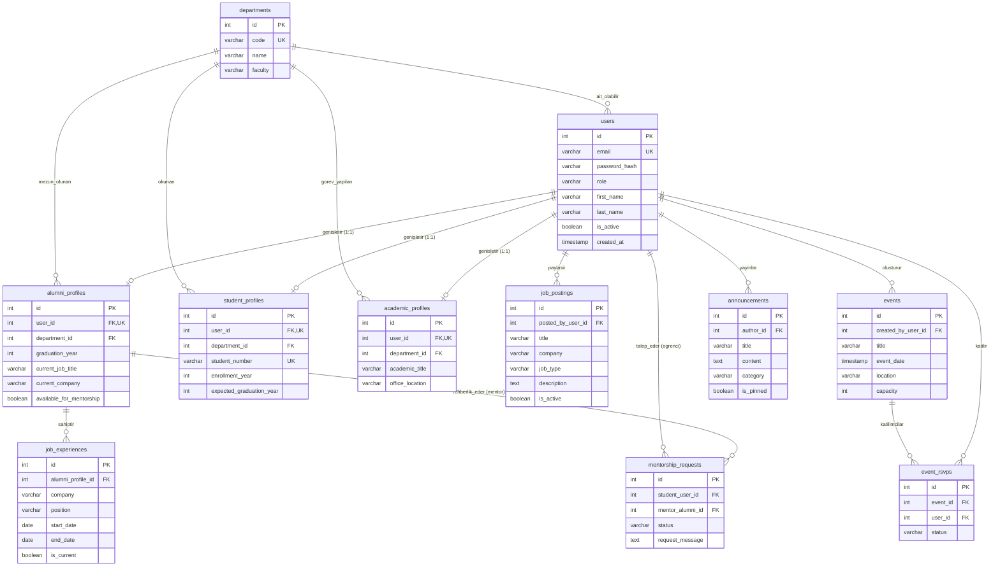

# 🗄️ Database Design Documentation (DDD)
## Alumni Tracking System

> **Belge Sürümü:** 1.0.0  
> **Tarih:** 2026-10-14  
> **Durum:** Üretildi ve Aktif (Implemented & Live Schema in PostgreSQL 16)  
> **Hedef RDBMS:** PostgreSQL 16+ (İlişkisel Veritabanı Mimarisi)  
> **Uygulama:** Bu şema `backend/src/db/schema.sql` dosyasında DDL olarak üretilmiş ve `alumni_db` PostgreSQL veritabanında aktif olarak oluşturulmuştur.

---

## 📑 İçindekiler
1. [Giriş ve Tasarım İlkeleri](#1-giriş-ve-tasarım-ilkeleri)
2. [Varlık İlişki Diyagramı (ER Diagram)](#2-varlık-ilişki-diyagramı-er-diagram)
3. [Tablo Tasarımları ve Veri Sözlüğü](#3-tablo-tasarımları-ve-veri-sözlüğü)
   - [3.1 departments (Bölümler)](#31-departments-bölümler)
   - [3.2 users (Temel Kullanıcı Hesabı)](#32-users-temel-kullanıcı-hesabı)
   - [3.3 alumni_profiles (Mezun Profilleri)](#33-alumni_profiles-mezun-profilleri)
   - [3.4 student_profiles (Öğrenci Profilleri)](#34-student_profiles-öğrenci-profilleri)
   - [3.5 academic_profiles (Akademik Personel Profilleri)](#35-academic_profiles-akademik-personel-profilleri)
   - [3.6 job_experiences (Kariyer ve İş Deneyimleri)](#36-job_experiences-kariyer-ve-iş-deneyimleri)
   - [3.7 job_postings (İş ve Staj İlanları)](#37-job_postings-iş-ve-staj-ilanları)
   - [3.8 mentorship_requests (Mentörlük Talepleri)](#38-mentorship_requests-mentörlük-talepleri)
   - [3.9 events (Etkinlikler)](#39-events-etkinlikler)
   - [3.10 event_rsvps (Etkinlik Katılım Durumları)](#310-event_rsvps-etkinlik-katılım-durumları)
   - [3.11 announcements (Duyurular)](#311-announcements-duyurular)
4. [İlişki ve Kardinalite Özeti](#4-ilişki-ve-kardinalite-özeti)
5. [İndeksleme ve Performans Optimizasyonları](#5-indeksleme-ve-performans-optimizasyonları)

---

## 1. Giriş ve Tasarım İlkeleri

Alumni Tracking System; mezunlar, aktif öğrenciler ve akademisyenler arasındaki etkileşimi, iş/staj ilanlarını, mentörlük eşleşmelerini ve etkinlik yönetimini sağlayan birleşik bir platformdur. 

### Temel Tasarım Prensipleri:
- **3. Normal Form (3NF):** Veri tekrarlarını önlemek ve tutarsızlıkları minimize etmek için 3NF standardında normalize edilmiştir.
- **Rol Tabanlı Ayrık Profil Modeli (Table Inheritance / Extension Pattern):** Ortak kimlik ve kimlik doğrulama verileri `users` tablosunda toplanmış; role özgü detaylar (`alumni_profiles`, `student_profiles`, `academic_profiles`) 1-e-1 ilişkilerle ayrıştırılmıştır.
- **Veri Bütünlüğü (Data Integrity & Foreign Keys):** Tüm ilişkiler katı `FOREIGN KEY` kısıtlamaları ve `ON DELETE` kurallarıyla (`CASCADE` / `SET NULL` / `RESTRICT`) korunur.
- **Audit İzlenebilirliği (Audit Trail):** Tüm ana tablolarda `created_at` ve `updated_at` zaman damgaları yer alır.

---

## 2. Varlık İlişki Diyagramı (ER Diagram)

---

## 3. Tablo Tasarımları ve Veri Sözlüğü

### 3.1 `departments` (Bölümler)
Üniversitedeki akademik bölümleri tutar.

| Sütun Adı | Veri Tipi | Kısıtlar (Constraints) | Açıklama |
|---|---|---|---|
| `id` | `SERIAL` | `PRIMARY KEY` | Benzersiz bölüm ID |
| `code` | `VARCHAR(20)` | `NOT NULL`, `UNIQUE` | Bölüm kodu (ör. `CENG`, `EEE`, `ME`) |
| `name` | `VARCHAR(150)` | `NOT NULL` | Bölüm adı (ör. Bilgisayar Mühendisliği) |
| `faculty` | `VARCHAR(150)` | `NOT NULL` | Bağlı olduğu fakülte adı |
| `description` | `TEXT` | `NULL` | Bölüm hakkında kısa bilgi |
| `created_at` | `TIMESTAMP` | `NOT NULL`, `DEFAULT NOW()` | Kayıt tarihi |

---

### 3.2 `users` (Temel Kullanıcı Hesabı)
Platformdaki tüm kullanıcıların temel kimlik, giriş ve rol bilgilerini içerir.

| Sütun Adı | Veri Tipi | Kısıtlar (Constraints) | Açıklama |
|---|---|---|---|
| `id` | `SERIAL` | `PRIMARY KEY` | Benzersiz kullanıcı ID |
| `email` | `VARCHAR(255)` | `NOT NULL`, `UNIQUE` | Giriş e-posta adresi |
| `password_hash` | `VARCHAR(255)` | `NOT NULL` | Argon2 veya bcrypt hash'i |
| `role` | `VARCHAR(30)` | `NOT NULL`, `CHECK (role IN ('alumni', 'student', 'academic_staff', 'admin'))` | Kullanıcı rolü |
| `first_name` | `VARCHAR(100)` | `NOT NULL` | Ad |
| `last_name` | `VARCHAR(100)` | `NOT NULL` | Soyad |
| `phone` | `VARCHAR(30)` | `NULL` | Telefon numarası |
| `profile_image_url` | `VARCHAR(500)` | `NULL` | Profil fotoğrafı URL adresi |
| `is_active` | `BOOLEAN` | `NOT NULL`, `DEFAULT TRUE` | Hesap aktif mi? |
| `is_verified` | `BOOLEAN` | `NOT NULL`, `DEFAULT FALSE` | E-posta doğrulaması tamamlandı mı? |
| `created_at` | `TIMESTAMP` | `NOT NULL`, `DEFAULT NOW()` | Kayıt oluşturulma zamanı |
| `updated_at` | `TIMESTAMP` | `NOT NULL`, `DEFAULT NOW()` | Son güncelleme zamanı |

---

### 3.3 `alumni_profiles` (Mezun Profilleri)
Mezun rolündeki kullanıcıların detaylı eğitim ve kariyer durumlarını barındırır (`users` ile 1-e-1 ilişki).

| Sütun Adı | Veri Tipi | Kısıtlar (Constraints) | Açıklama |
|---|---|---|---|
| `id` | `SERIAL` | `PRIMARY KEY` | Profil ID |
| `user_id` | `INTEGER` | `NOT NULL`, `UNIQUE`, `REFERENCES users(id) ON DELETE CASCADE` | İlgili kullanıcı |
| `department_id` | `INTEGER` | `NOT NULL`, `REFERENCES departments(id) ON DELETE RESTRICT` | Mezun olunan bölüm |
| `graduation_year` | `SMALLINT` | `NOT NULL`, `CHECK (graduation_year >= 1950)` | Mezuniyet yılı |
| `degree` | `VARCHAR(50)` | `NOT NULL`, `DEFAULT 'Bachelor'` | Lisans / Yüksek Lisans / Doktora |
| `current_job_title` | `VARCHAR(150)` | `NULL` | Güncel pozisyon/ünvan |
| `current_company` | `VARCHAR(150)` | `NULL` | Çalıştığı şirket/kurum |
| `current_city` | `VARCHAR(100)` | `NULL` | İkamet ettiği şehir / ülke |
| `linkedin_url` | `VARCHAR(300)` | `NULL` | LinkedIn profil bağlantısı |
| `bio` | `TEXT` | `NULL` | Özgeçmiş veya kısa biyografi |
| `available_for_mentorship` | `BOOLEAN` | `NOT NULL`, `DEFAULT FALSE` | Öğrencilere mentörlük vermeye açık mı? |
| `updated_at` | `TIMESTAMP` | `NOT NULL`, `DEFAULT NOW()` | Güncelleme zamanı |

---

### 3.4 `student_profiles` (Öğrenci Profilleri)
Aktif öğrenci rolündeki kullanıcıların detaylarını barındırır (`users` ile 1-e-1 ilişki).

| Sütun Adı | Veri Tipi | Kısıtlar (Constraints) | Açıklama |
|---|---|---|---|
| `id` | `SERIAL` | `PRIMARY KEY` | Profil ID |
| `user_id` | `INTEGER` | `NOT NULL`, `UNIQUE`, `REFERENCES users(id) ON DELETE CASCADE` | İlgili kullanıcı |
| `department_id` | `INTEGER` | `NOT NULL`, `REFERENCES departments(id) ON DELETE RESTRICT` | Okuduğu bölüm |
| `student_number` | `VARCHAR(30)` | `NOT NULL`, `UNIQUE` | Öğrenci numarası |
| `enrollment_year` | `SMALLINT` | `NOT NULL` | Giriş yılı |
| `expected_graduation_year` | `SMALLINT` | `NOT NULL` | Tahmini mezuniyet yılı |
| `degree` | `VARCHAR(50)` | `NOT NULL`, `DEFAULT 'Bachelor'` | Lisans / Yüksek Lisans |
| `interests` | `TEXT` | `NULL` | İlgi alanları ve teknolojiler |
| `career_goals` | `TEXT` | `NULL` | Kariyer hedefleri |
| `updated_at` | `TIMESTAMP` | `NOT NULL`, `DEFAULT NOW()` | Güncelleme zamanı |

---

### 3.5 `academic_profiles` (Akademik Personel Profilleri)
Öğretim görevlileri ve fakülte danışmanlarının bilgilerini barındırır (`users` ile 1-e-1 ilişki).

| Sütun Adı | Veri Tipi | Kısıtlar (Constraints) | Açıklama |
|---|---|---|---|
| `id` | `SERIAL` | `PRIMARY KEY` | Profil ID |
| `user_id` | `INTEGER` | `NOT NULL`, `UNIQUE`, `REFERENCES users(id) ON DELETE CASCADE` | İlgili akademisyen |
| `department_id` | `INTEGER` | `NOT NULL`, `REFERENCES departments(id) ON DELETE RESTRICT` | Görevli olduğu bölüm |
| `academic_title` | `VARCHAR(100)` | `NOT NULL` | Akademik unvan (Prof. Dr., Doç. Dr., vb.) |
| `office_location` | `VARCHAR(150)` | `NULL` | Ofis numarası / bina |
| `research_areas` | `TEXT` | `NULL` | Çalışma ve araştırma alanları |
| `office_hours` | `VARCHAR(200)` | `NULL` | Danışmanlık ve ofis saatleri |
| `updated_at` | `TIMESTAMP` | `NOT NULL`, `DEFAULT NOW()` | Güncelleme zamanı |

---

### 3.6 `job_experiences` (Kariyer ve İş Deneyimleri)
Mezunların geçmiş ve mevcut çalışma tecrübelerini kronolojik olarak saklar.

| Sütun Adı | Veri Tipi | Kısıtlar (Constraints) | Açıklama |
|---|---|---|---|
| `id` | `SERIAL` | `PRIMARY KEY` | Deneyim ID |
| `alumni_profile_id`| `INTEGER` | `NOT NULL`, `REFERENCES alumni_profiles(id) ON DELETE CASCADE` | İlgili mezun profili |
| `company` | `VARCHAR(150)` | `NOT NULL` | Şirket adı |
| `position` | `VARCHAR(150)` | `NOT NULL` | Rol / Unvan |
| `start_date` | `DATE` | `NOT NULL` | Başlangıç tarihi |
| `end_date` | `DATE` | `NULL` | Bitiş tarihi (aktif çalışıyorsa NULL) |
| `is_current` | `BOOLEAN` | `NOT NULL`, `DEFAULT FALSE` | Güncel işi mi? |
| `description` | `TEXT` | `NULL` | Görev tanımı ve sorumluluklar |

---

### 3.7 `job_postings` (İş ve Staj İlanları)
Mezunlar veya akademisyenler tarafından paylaşılan iş/staj fırsatları.

| Sütun Adı | Veri Tipi | Kısıtlar (Constraints) | Açıklama |
|---|---|---|---|
| `id` | `SERIAL` | `PRIMARY KEY` | İlan ID |
| `posted_by_user_id`| `INTEGER` | `NOT NULL`, `REFERENCES users(id) ON DELETE CASCADE` | İlanı yayınlayan kullanıcı |
| `title` | `VARCHAR(200)` | `NOT NULL` | İlan başlığı |
| `company` | `VARCHAR(150)` | `NOT NULL` | Şirket / Kurum |
| `location` | `VARCHAR(100)` | `NOT NULL` | Konum (Şehir / Remote) |
| `job_type` | `VARCHAR(30)` | `NOT NULL`, `CHECK (job_type IN ('Full-time', 'Part-time', 'Internship', 'Contract', 'Remote'))` | Çalışma biçimi |
| `description` | `TEXT` | `NOT NULL` | İlan açıklaması ve aranan kriterler |
| `application_link` | `VARCHAR(500)` | `NULL` | Başvuru linki veya e-posta |
| `is_active` | `BOOLEAN` | `NOT NULL`, `DEFAULT TRUE` | İlan yayında mı? |
| `created_at` | `TIMESTAMP` | `NOT NULL`, `DEFAULT NOW()` | İlan yayın tarihi |
| `expires_at` | `TIMESTAMP` | `NULL` | Son başvuru tarihi |

---

### 3.8 `mentorship_requests` (Mentörlük Talepleri)
Öğrencilerin mezunlara gönderdiği rehberlik/mentörlük istekleri ve durumları.

| Sütun Adı | Veri Tipi | Kısıtlar (Constraints) | Açıklama |
|---|---|---|---|
| `id` | `SERIAL` | `PRIMARY KEY` | Talep ID |
| `student_user_id` | `INTEGER` | `NOT NULL`, `REFERENCES users(id) ON DELETE CASCADE` | İstekte bulunan öğrenci |
| `mentor_alumni_id`| `INTEGER` | `NOT NULL`, `REFERENCES alumni_profiles(id) ON DELETE CASCADE` | Mentör mezun profili |
| `status` | `VARCHAR(30)` | `NOT NULL`, `DEFAULT 'pending'`, `CHECK (status IN ('pending', 'accepted', 'rejected', 'completed'))` | Talep durumu |
| `request_message` | `TEXT` | `NOT NULL` | Öğrencinin mentörlük talep notu |
| `response_message`| `TEXT` | `NULL` | Mentörün yanıt notu |
| `created_at` | `TIMESTAMP` | `NOT NULL`, `DEFAULT NOW()` | İstek oluşturulma tarihi |
| `updated_at` | `TIMESTAMP` | `NOT NULL`, `DEFAULT NOW()` | Yanıtlanma tarihi |

---

### 3.9 `events` (Etkinlikler)
Akademik personel veya yöneticiler tarafından düzenlenen kariyer günleri, mezun buluşmaları vb.

| Sütun Adı | Veri Tipi | Kısıtlar (Constraints) | Açıklama |
|---|---|---|---|
| `id` | `SERIAL` | `PRIMARY KEY` | Etkinlik ID |
| `created_by_user_id`| `INTEGER` | `NOT NULL`, `REFERENCES users(id) ON DELETE RESTRICT` | Düzenleyen yetkili |
| `title` | `VARCHAR(200)` | `NOT NULL` | Etkinlik başlığı |
| `description` | `TEXT` | `NOT NULL` | Etkinlik detayları |
| `event_date` | `TIMESTAMP` | `NOT NULL` | Etkinlik başlangıç zamanı |
| `location` | `VARCHAR(255)` | `NOT NULL` | Yer (Fiziksel amfi veya Online Link) |
| `category` | `VARCHAR(50)` | `NOT NULL`, `DEFAULT 'General'` | Kariyer, Seminer, Pilav Günü vb. |
| `capacity` | `INTEGER` | `NULL`, `CHECK (capacity > 0)` | Katılımcı kontenjanı |
| `created_at` | `TIMESTAMP` | `NOT NULL`, `DEFAULT NOW()` | Oluşturulma tarihi |

---

### 3.10 `event_rsvps` (Etkinlik Katılım Durumları)
Kullanıcıların etkinliklere katılım kayıtları.

| Sütun Adı | Veri Tipi | Kısıtlar (Constraints) | Açıklama |
|---|---|---|---|
| `id` | `SERIAL` | `PRIMARY KEY` | Katılım ID |
| `event_id` | `INTEGER` | `NOT NULL`, `REFERENCES events(id) ON DELETE CASCADE` | İlgili etkinlik |
| `user_id` | `INTEGER` | `NOT NULL`, `REFERENCES users(id) ON DELETE CASCADE` | Katılımcı kullanıcı |
| `status` | `VARCHAR(30)` | `NOT NULL`, `DEFAULT 'attending'`, `CHECK (status IN ('attending', 'maybe', 'declined'))` | Katılım durumu |
| `created_at` | `TIMESTAMP` | `NOT NULL`, `DEFAULT NOW()` | RSVP zamanı |

> *Not:* `(event_id, user_id)` üzerinde birleşik benzersiz kısıtlama (`UNIQUE`) tanımlanır.

---

### 3.11 `announcements` (Duyurular)
Sistem genelindeki duyurular (mevcut `AnnouncementModel` ile uyumludur).

| Sütun Adı | Veri Tipi | Kısıtlar (Constraints) | Açıklama |
|---|---|---|---|
| `id` | `SERIAL` | `PRIMARY KEY` | Duyuru ID |
| `author_id` | `INTEGER` | `NOT NULL`, `REFERENCES users(id) ON DELETE RESTRICT` | Duyuran kullanıcı |
| `title` | `VARCHAR(255)` | `NOT NULL` | Duyuru başlığı |
| `content` | `TEXT` | `NOT NULL` | Duyuru gövdesi |
| `category` | `VARCHAR(50)` | `NOT NULL`, `DEFAULT 'General'` | Kategori |
| `is_pinned` | `BOOLEAN` | `NOT NULL`, `DEFAULT FALSE` | Sabitlenmiş duyuru mu? |
| `created_at` | `TIMESTAMP` | `NOT NULL`, `DEFAULT NOW()` | Oluşturulma tarihi |
| `updated_at` | `TIMESTAMP` | `NOT NULL`, `DEFAULT NOW()` | Son güncelleme |

---

## 4. İlişki ve Kardinalite Özeti

| Birincil Tablo | İlişkili Tablo | Kardinalite | Açıklama |
|---|---|---|---|
| `departments` | `alumni_profiles` | `1 : N` | Bir bölümden birçok mezun çıkar. |
| `departments` | `student_profiles` | `1 : N` | Bir bölümde birçok öğrenci okur. |
| `departments` | `academic_profiles`| `1 : N` | Bir bölümde birçok akademisyen görev alır. |
| `users` | `alumni_profiles` | `1 : 1` | Bir kullanıcı en fazla bir mezun profiline sahiptir. |
| `users` | `student_profiles` | `1 : 1` | Bir kullanıcı en fazla bir öğrenci profiline sahiptir. |
| `users` | `academic_profiles`| `1 : 1` | Bir kullanıcı en fazla bir akademik profile sahiptir. |
| `alumni_profiles` | `job_experiences` | `1 : N` | Bir mezunun birden fazla iş deneyimi olabilir. |
| `users` | `job_postings` | `1 : N` | Bir kullanıcı birden fazla iş ilanı paylaşabilir. |
| `users` (öğrenci) | `mentorship_requests`| `1 : N` | Öğrenci birden fazla mentöre talep açabilir. |
| `alumni_profiles` | `mentorship_requests`| `1 : N` | Bir mentöre birden fazla talep gelebilir. |
| `events` | `event_rsvps` | `1 : N` | Bir etkinliğe birçok kişi RSVP yapabilir. |

---

## 5. İndeksleme ve Performans Optimizasyonları

Arama ve filtreleme işlemlerinde yüksek performans için aşağıdaki indeksler planlanmıştır:

1. **Arama ve Filtreleme İndeksleri:**
   - `idx_users_role`: `users(role)`
   - `idx_alumni_dept_year`: `alumni_profiles(department_id, graduation_year)`
   - `idx_alumni_mentorship`: `alumni_profiles(available_for_mentorship) WHERE available_for_mentorship = TRUE`
   - `idx_job_postings_active`: `job_postings(is_active, created_at DESC)`
2. **Etkinlik & Katılım İndeksleri:**
   - `idx_events_date`: `events(event_date)`
   - `idx_event_rsvps_unique`: `UNIQUE (event_id, user_id)`
